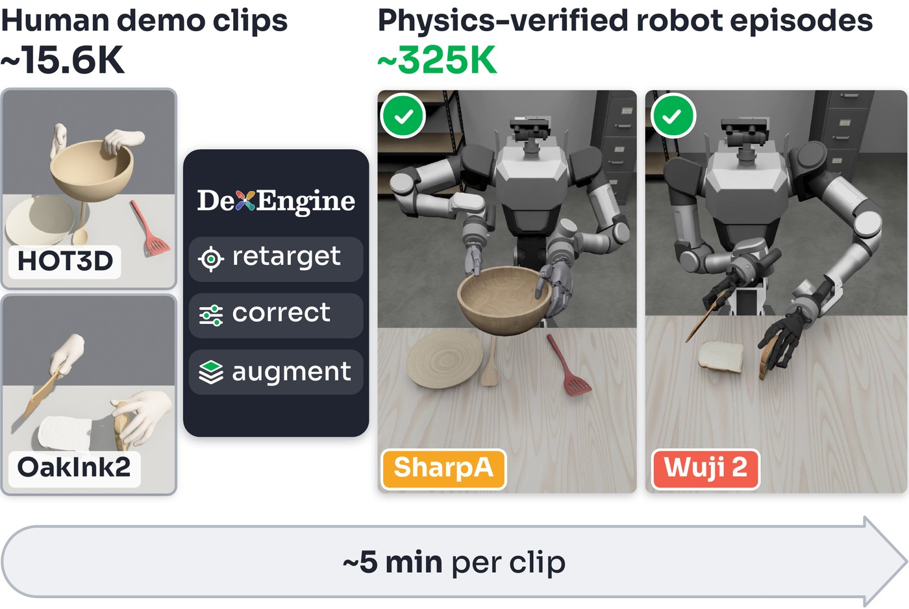

<p align="center">
  <picture>
    <source media="(prefers-color-scheme: dark)" srcset="docs/assets/dexengine_wordmark_dark.png">
    
  </picture>
</p>

<h3 align="center">Scaling Human Demonstrations into Physically Executable Whole-Robot Data</h3>

<p align="center">
  
  <a href="https://wongyun-yu.github.io/dexengine/"></a>
  <a href="https://huggingface.co/datasets/Wongyun/DexEngine/tree/v0"></a>
</p>

<p align="center">
  <a href="LICENSE"></a>
  
  
</p>

<p align="center">
  
</p>

DexEngine turns public human hand–object captures into train-ready LeRobot datasets for a bimanual robot with
dexterous hands. The input is a capture with the MANO pose of each human hand and the 6-DoF pose of each object; the
output is one LeRobot dataset per robot hand and source dataset. Every episode is recorded from a physics rollout on
the robot. The method is described in Sec. 3 of the paper.

- **Whole robot.** The human hands are retargeted to the robot's hands; a scene placement, arm IK and retiming then put
  the motion on both arms.
- **Physically executable.** A residual RL policy in Isaac Lab corrects each bundle of clips, and a judge in a fresh
  process decides which clips are accepted.
- **Ready to train on.** Each episode holds joint states, policy actions, object poses, contact forces, ego stereo,
  exocentric and depth images, and a language instruction.

## Pipeline

| | Stage | What it does | Entry point |
|---|---|---|---|
| 1 | Retargeting | raw capture → MANO layer → floating robot hands | `python -m dexengine.data.read_raw` |
| 2 | IK grounding | placement search, arm IK and retiming for both arms | `bash scripts/stage2_ground.sh` |
| 3 | RL in Isaac Lab | residual PPO per bundle of clips, then the judge | `python scripts/stage3_rl.py` |
| 4 | Recording | accepted clips with pose and visual augmentation | `python scripts/stage4_record.py` |

A full pass for one hand and one dataset: [docs/pipeline.md](docs/pipeline.md#a-full-pass-for-one-hand-and-one-dataset).

## Robots, hands and datasets

| | |
|---|---|
| Arm | Rainbow Robotics RB-Y1 (`rby1`) |
| Hands | Sharpa Wave (`sharpa_wave`) · Wuji Hand 2 (`wuji2`) · ROBOTERA XHand Pro (`xhand_pro`) · Tesollo DG-5F-S (`dg5f_s`) |
| Datasets | ARCTIC · DexCanvas · GRAB · H2O · HOCAP · HOT3D · HRDexDB · OakInk2 · TACO |

The registries print the ids: `python -m dexengine.core.paths --what combo-ids` and `--what datasets`. Per-dataset
and per-hand notes: [docs/datasets.md](docs/datasets.md) · [docs/hands.md](docs/hands.md).

## Getting started

```bash
git lfs install && git lfs pull
# the retargeting environment
python -m venv .venv && .venv/bin/pip install -e ".[retarget,test]"
# the robot and hand files
python -m dexengine.robots.vendor fetch --data-root <data root>
python -m dexengine.robots.vendor build --data-root <data root>
```

Stages 2–4 also need Isaac Lab; the MANO models and four shipped inputs are downloaded separately. Every step:
[docs/installation.md](docs/installation.md).

## Documentation

| Topic | Contents |
|---|---|
| [Installation](docs/installation.md) | environments, robot and hand assets, tests |
| [Pipeline](docs/pipeline.md) | a full pass, stage contracts, clip acceptance |
| [Datasets](docs/datasets.md) | readers, per-dataset notes, shipped inputs |
| [Hands](docs/hands.md) | hand assets, adding a hand |
| [Configuration](docs/configuration.md) | configuration files, data root, data layout, environment variables |
| [Cluster](docs/cluster.md) | local GPUs, Slurm, Kubernetes |
| [Changes from v0](docs/changes_from_v0.md) | every behaviour change of v0.1 |
| [Paper experiments](experiments/README.md) | the code behind the paper's tables |

## What changed in v0.1

v0.1 is v0 with a list of behaviour changes, each stated in [docs/changes_from_v0.md](docs/changes_from_v0.md). Among
them:

- Scene rules apply to every dataset, and the robot collides with still objects during RL.
- At frame 0, a main object that starts inside a colliding body is moved out or its clip dropped, and deep
  hand–object penetration is repaired over the whole spawn-hold window.
- Hand friction, mount offset and gravity settings are applied to both arms alike.
- A still object receives a moved object that ends near its surface or with its centre inside its convex hull.

## License

Apache License 2.0 ([`LICENSE`](LICENSE), [`NOTICE`](NOTICE)); third-party code and assets are listed in
[`THIRD_PARTY.md`](THIRD_PARTY.md). Source datasets are not distributed: download each under its own terms
([docs/datasets.md](docs/datasets.md)).
